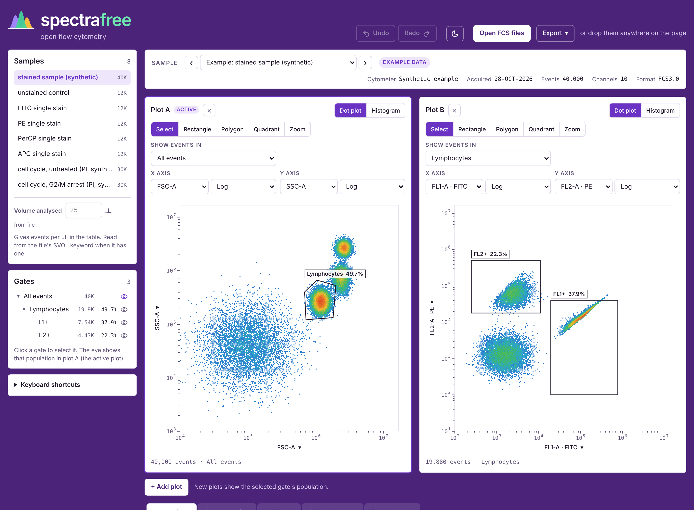
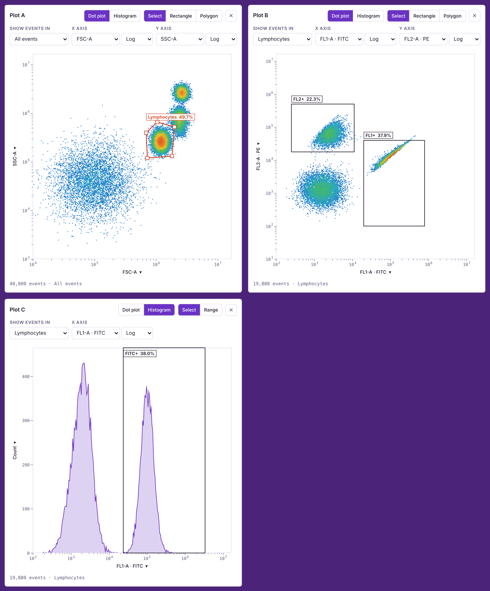
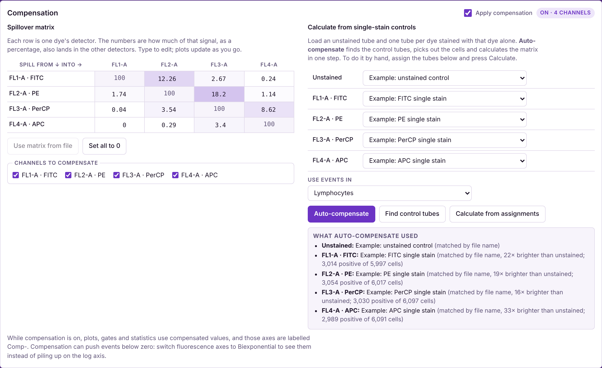
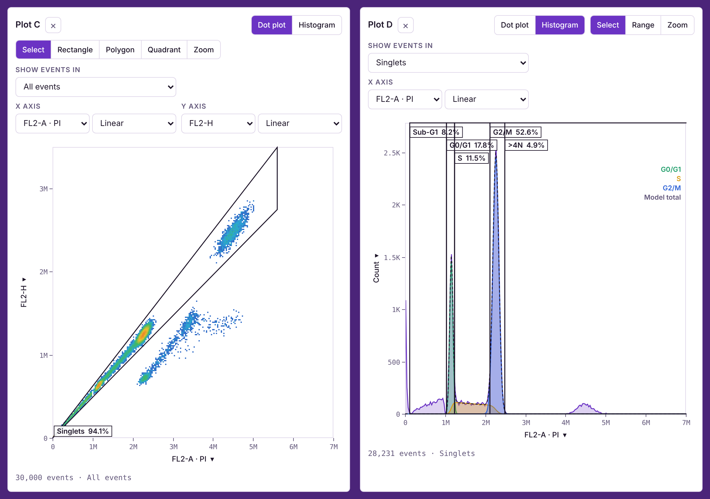
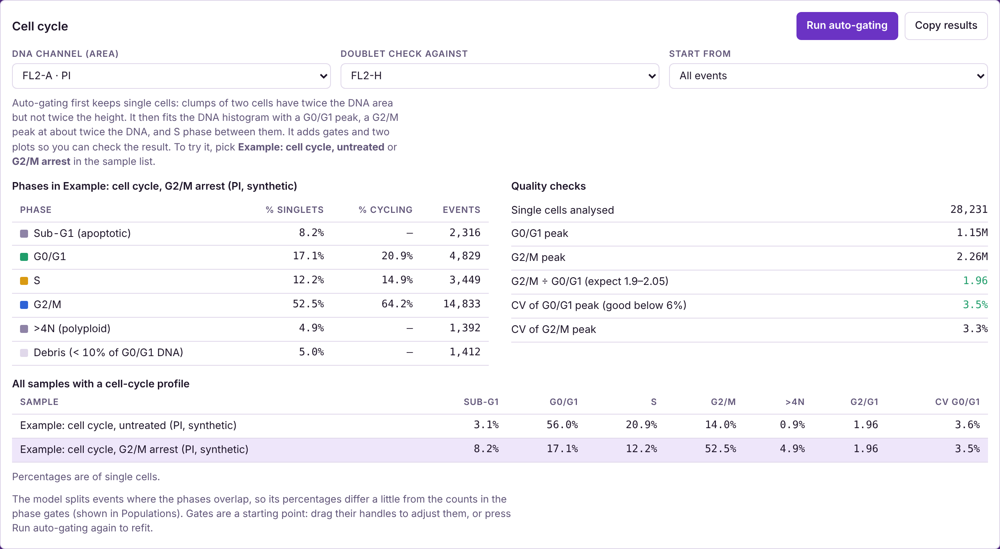
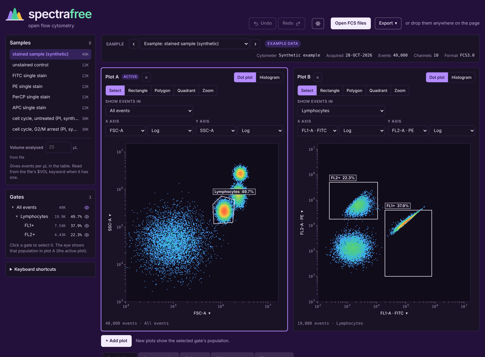
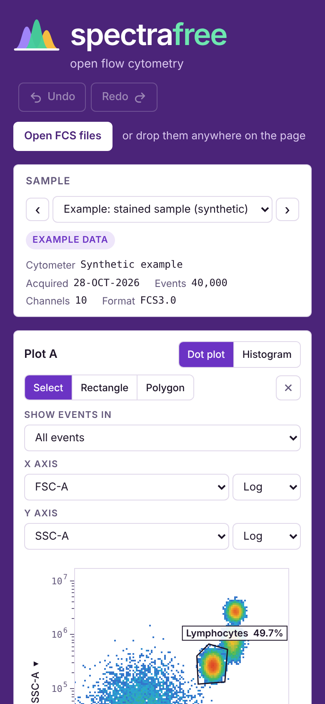

  

<h1 align="center">SpectraFree</h1>

<strong>Open-source flow cytometry (FACS) analysis that runs in your web browser.</strong> 
Gating, compensation and cell-cycle analysis in a single HTML file. Your data never leaves your computer.

  
  
  

## Why SpectraFree

SpectaFree is an open source flow cytometry software. Open it, drop in FCS files, and analyse. It is built as a **training tool** first: it ships with synthetic example data, so new users can learn gating, compensation and cell-cycle analysis without needing access to an instrument.

SpectraFree was "vibe coded": it was designed and written in conversation with an AI assistant (Claude, by Anthropic), then tested with automated checks against synthetic data with known answers. Read [Validation](#validation) and [Limitations](#limitations) before you rely on it.

## Try it

Online or offline with your own data. Export FCS files from your cytometer software (FCS 2.0, 3.0 or 3.1), then click **Open FCS files** or drag them onto the page. Files are read inside the browser. Nothing is uploaded anywhere.

## Features

### Plots and gating
- **Any number of plots** (up to 8), each a density dot plot or a histogram. **+ Add plot** opens a new plot on the selected gate's population.
- **Change channels from the axis**, as in desktop FACS software: right-click an axis title for every channel and the scale (Linear, Log, Biexponential).
- **Rectangle, polygon and histogram range gates**, nested to any depth. Drawing a gate moves the next plot into that population.
- **Resize gates by their handles**: corners and sides for rectangles (they stay rectangular), corners for polygons, ends for ranges. Double-click a polygon edge to add a corner, or a corner to remove it.
- **Gates apply across samples** by channel name. Switch tubes with ‹ › or the arrow keys and every plot and percentage updates.
- **Population table** with events, % of parent, % of total, median, mean and CV. **Copy table** pastes straight into Excel.

### Compensation
- **Editable spillover matrix**, applied live to plots, gates and statistics. Compensated axes are labelled `Comp-`.
- **Auto-compensate**: one click finds the unstained tube and one single-stain tube per channel (by file name, or by brightness when the names give no clue), gates out debris and saturated events automatically, and calculates the matrix. It lists the tubes it used so you can check them.
- **Calculate from assignments** if you prefer to choose the tubes yourself, or **Use matrix from file** when an FCS file carries a `$SPILLOVER` keyword.

### Cell-cycle analysis
- **One-click auto-gating** for DNA-content staining (PI, DAPI, 7-AAD, DRAQ5 and similar).
- **Doublet removal** from DNA area against height (or width).
- **Histogram model fit** in the Dean-Jett-Fox style: Gaussian G0/G1 and G2/M peaks, plus an S-phase component that extends under both peaks.
- **Results**: Sub-G1, G0/G1, S, G2/M and >4N percentages, quality checks (G2/G1 ratio, peak CVs), and a table comparing every loaded sample.
- **Adjustable gates**: auto-gating adds ordinary gates, so you can adjust them with the handles or re-run the fit.

### Everything else
- **Undo and Redo** for gates, plots, compensation and cell-cycle gating (Ctrl+Z, Ctrl+Shift+Z or Ctrl+Y; ⌘ on a Mac).
- **Light and dark themes** follow your system setting. **Phone and tablet layouts** work too.
- **File keyword viewer** for every TEXT keyword in the FCS file.

| Dark mode | Phone |
|---|---|
|  |  |

## Example data

Eight synthetic tubes load on first open, labelled **Example**. They are generated in the browser with known answers, so they double as teaching material:

| Tube | What it teaches |
|---|---|
| Stained sample | Scatter gating, nested gates, FITC and PE populations, the effect of spillover |
| Unstained + four single stains (FITC, PE, PerCP, APC) | Building a compensation matrix by hand or with Auto-compensate |
| Cell cycle, untreated (PI) | Doublet discrimination and a normal cell-cycle profile |
| Cell cycle, G2/M arrest (PI) | A drug-arrested profile for comparison |

The example tubes and their gates are removed as soon as you open your own files.

## Validation

The automated checks in [`tests/smoke.mjs`](tests/smoke.mjs) run the app in a headless browser and compare its answers with values built into the synthetic data:

| Check | Built into the data | SpectraFree |
|---|---|---|
| FITC → PE spillover | 12.0% | 12.3% |
| PE → PerCP spillover | 18.0% | 18.2% |
| PerCP → APC spillover | 8.0% | 8.6% |
| Control tubes found with meaningless file names | 5 of 5 | 5 of 5 |
| Untreated cell cycle: G0/G1 / S / G2/M | 55.2 / 21.7 / 12.8% | 55.9 / 20.9 / 14.0% |
| Arrested cell cycle: G0/G1 / S / G2/M | 16.8 / 12.8 / 51.3% | 17.1 / 12.2 / 52.5% |
| FCS reading: float, 16-bit integer, log-amplified, FCS 2.0, escaped delimiters | correct values | correct values |

**These checks use synthetic data only.** SpectraFree has not yet been compared against FlowJo, FCS Express, ModFit or instrument software on real samples. If you do that comparison, please share the results in an issue.

## Supported files

- FCS 2.0, 3.0 and 3.1, list mode
- Data types I (8, 16 and 32-bit integers), F (32-bit float) and D (64-bit float), little- or big-endian
- `$PnE` log amplification, `$PnG` gain, `$PnR` range masking
- `$SPILLOVER`, `$SPILL` and `SPILL` matrices
- Designed around BD Accuri C6 / C6 Plus channel names (FSC-A, SSC-A, FL1-A to FL4-A, FL2-H…), and works with any cytometer's channel names

## Limitations

- **Not validated for clinical or diagnostic use.** Use it for training, teaching and exploratory research.
- **No saved workspaces yet**: gates and the compensation matrix are lost when you close the page.
- **One compensation matrix** applies to all samples. Height (-H) channels are not compensated unless you tick them.
- **No quadrant gates, dimensionality reduction (t-SNE/UMAP), clustering or batch export** yet.
- **Files of more than about a million events** work, but get slower; live updates while dragging a gate switch off for large files.
- **The cell-cycle model is a simplified Dean-Jett-Fox fit.** It expects a clear G0/G1 peak with a G2/M peak at about twice the DNA.

## How it works

Everything lives in [`index.html`](index.html): about 2,000 lines of plain HTML, CSS and JavaScript, with no framework, no build step and no external libraries. The only network request is for Google Fonts, and the app works without it.

- **FCS parsing** reads the HEADER, TEXT and DATA segments straight from the file's bytes.
- **Plots** are drawn on HTML canvas as binned density images with a pseudocolour scale.
- **Gates** are stored in data coordinates and tested in display space, so they stay correct when you change scales. Edges drawn on a plot border extend to infinity, so off-scale events stay inside.
- **Compensation** multiplies each event by the inverse of the spillover matrix.
- **Cell cycle** fits the DNA histogram as described above.

## Contributing

Bug reports, real-data comparisons and pull requests are welcome. See [CONTRIBUTING.md](CONTRIBUTING.md) to run the tests and learn how the code is organised. A step-by-step training walkthrough is in [docs/user-guide.md](docs/user-guide.md).

## Licence

SpectraFree is free software: you can redistribute it and/or modify it under the terms of the [GNU General Public License v3.0](LICENSE) or (at your option) any later version. It is distributed in the hope that it will be useful, but **without any warranty**; see the licence for details.

Copyright © 2026 Bezoon5.

FCS is a file standard of the International Society for Advancement of Cytometry (ISAC).
