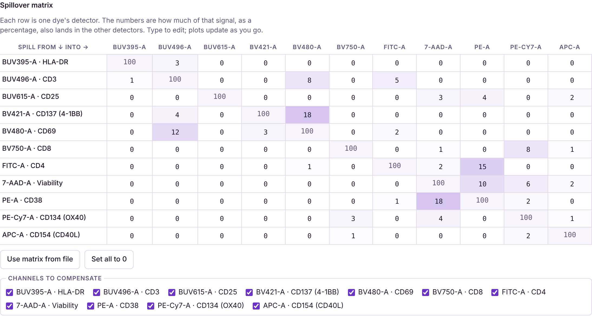

# SpectraFree user guide

A hands-on walkthrough using the example data that loads when you first open SpectraFree. Each exercise takes 5–10 minutes. Nothing needs installing: open `index.html` in a browser.

- [1. Find your way around](#1-find-your-way-around)
- [2. Gating](#2-gating)
- [3. Compensation](#3-compensation)
- [4. Cell-cycle analysis](#4-cell-cycle-analysis)
- [5. Names, pictures and exports](#5-names-pictures-and-exports)
- [6. Working with your own files](#6-working-with-your-own-files)
- [7. Viewing tools: zoom, overlays, backgating, styles](#7-viewing-tools-zoom-overlays-backgating-styles)
- [8. A multicolour experiment: T-cell activation](#8-a-multicolour-experiment-t-cell-activation)
- [Keyboard and mouse reference](#keyboard-and-mouse-reference)
- [Glossary](#glossary)

---

## 1. Find your way around

The page has:

| Area | What it does |
|---|---|
| **Header** | Undo / Redo, the light/dark theme button, **Open FCS files** and **Export** |
| **Sidebar: Samples** | Every open tube with its event count. Click one to switch to it. Below the list, **Volume analysed** gives events per µL |
| **Sidebar: Gates** | The gate hierarchy with counts and % of parent. Click a gate to select it; the eye shows that population in the active plot; ▼ folds a branch |
| **Sample bar** | The current tube, with ‹ › to step through tubes and the file's details |
| **Plots** | Plot A, Plot B and any you add. Each is a dot plot or a histogram. The plot you last clicked is **active** (outlined); keyboard tools act on it |
| **Tabs** | **Populations** (statistics table), **Compensation**, **Cell cycle**, **Channel names**, **File keywords** |

On a phone, the sidebar moves below the plots.

**Try it:** click the tubes in the sidebar one by one and watch both plots and the counts change. The gates stay put: they apply to every tube that has the same channel names.

SpectraFree saves your gates, plots and settings in this browser as you work. Next time you open it, a bar offers to restore your last session.

## 2. Gating

### 2.1 Scatter gate
1. Choose **Example: stained sample** in the sample bar.
2. Plot A shows FSC-A against SSC-A. The small, low-scatter cloud on the left is debris; the three clusters on the right are cells.
3. The **Lymphocytes** gate is already drawn around the lowest-SSC cell cluster. Click it: square handles appear on its corners.
4. Drag a corner outward and watch the percentage on the gate, and the cell count under Plot B, change as you drag.
5. Press **Ctrl+Z** (⌘Z on a Mac) to undo.

### 2.2 Draw your own gate
1. In Plot A, choose **Polygon**.
2. Click around the middle cluster (monocytes): one click per corner. Double-click, or click the first corner again, to close the polygon.
3. The new gate is called P4. Rename it in the **Populations** table, for example to *Monocytes*.
4. Click **+ Add plot**. The new plot opens on the selected gate's population.

### 2.3 Fluorescence gates and changing channels
1. Plot B shows FL1-A (FITC) against FL2-A (PE) for the Lymphocytes population, with **FL1+** and **FL2+** gates.
2. Right-click the X-axis title, **FL1-A · FITC ▾**. Pick **FL4-A · APC** to see the APC-positive subset, then switch back.
3. Switch Plot B to **Histogram**, choose **Range**, and drag across the bright FL1 peak to make a range gate.

### 2.4 Quadrant gates
1. Delete the FL1+ and FL2+ gates (click each, then press Delete), so Plot B is clear.
2. Choose **Quadrant** and click where the negative and positive populations divide: one vertical and one horizontal line appear.
3. The plot corners show four populations: **Q1** FITC− PE+ (top left), **Q2** FITC+ PE+, **Q3** FITC+ PE−, **Q4** FITC− PE−. They always add up to 100% of the parent.
4. Drag the centre square to move both lines, drag one line to move just that line, or drag anywhere inside a quadrant to move the whole cross.
5. Each quadrant is an ordinary population: pick it under **Show events in** on another plot to look inside it. Deleting any quadrant removes all four; Undo brings them back.

> **Teaching point:** look at the FL1+ population in Plot B. It slopes upwards into FL2. That is spillover: FITC light leaking into the PE detector. Section 3 removes it.

## 3. Compensation

### 3.1 One click
1. Open the **Compensation** tab and press **Auto-compensate**.
2. Read **What Auto-compensate used**: it found the unstained tube and one single-stain tube for each channel.
3. The spillover matrix fills in. FITC into FL2 is about 12%, and PE into FL3 about 18%.
4. Go back to Plot B. The FL1+ population is now level: the spillover is gone. The axes now read **Comp-FL1-A** and **Comp-FL2-A**.
5. Set both of Plot B's axes to **Biexponential**. Compensation correctly pushes some values below zero, and a log axis cannot show them.

### 3.2 By hand (to understand what the button does)
1. Press **Set all to 0**.
2. Check the tube assignments under **Calculate from single-stain controls**, then press **Calculate from assignments**.
3. For each control, SpectraFree takes the stained cells (brighter than 99.5% of unstained cells in that dye's own channel). It then works out how much brighter they are in every *other* channel than the unstained cells. That ratio is the spillover.

### 3.3 Edit a value
Type a new number into the FL1-A → FL2-A cell, for example 20. The FL1+ population tilts downwards, which is over-compensation. Type 12 to fix it. This is the quickest way to learn what a correct matrix looks like.

## 4. Cell-cycle analysis

1. In the sidebar, set **Example data** to **Cell cycle: PI**. Two tubes load (untreated and G2/M arrest) and the **Cell cycle** tab opens. Plot B shows DNA area against height and plot C the DNA histogram, both ungated so you can see the raw data first.
2. The DNA channel is set to FL2-A · PI and the doublet check to FL2-H. Press **Run auto-gating**.
3. Plots B and C are gated:
   - **DNA area against height**: single cells form a straight diagonal band. Clumps of two cells sit below it, because they have twice the DNA area but not twice the height. The **Singlets** gate keeps the band.
   - **DNA histogram** of single cells, with the fitted G0/G1 (green), S (amber) and G2/M (blue) components and the model total (dashed).
4. Read the results: about 56% G0/G1, 21% S and 14% G2/M. Check the quality panel: a G2/G1 ratio of 1.96 and a G0/G1 CV of 3.6% are good.
5. Press **›** to move to **G2/M arrest**. The fit updates by itself: G2/M rises to about 52%, and sub-G1 (apoptotic cells) to about 8%.
6. The comparison table lists both samples side by side. **Copy results** pastes them into a spreadsheet.

> **Why the model percentages differ from the gate counts:** S-phase cells near the start and end of S phase overlap the G0/G1 and G2/M peaks. The model splits the overlap between phases; a simple range gate cannot. Model values are the better estimate.

## 5. Names, pictures and exports

### 5.1 Rename channels
1. Right-click the X-axis title of Plot B and choose **Rename FL1-A…**.
2. Type a marker and dye, for example *CD45 RB545*, and press Enter. The axis now reads **FL1-A · CD45 RB545**, and so do the menus, the compensation table and new quadrant names.
3. To rename several channels at once, open the **Channel names** tab. **Use file name** puts a channel back to the name stored in the FCS file.

### 5.2 Put a plot into a report or slide
1. Right-click inside a plot and choose **Copy plot (for Word, PowerPoint, Excel)**.
2. Paste into your document. The picture is high resolution, on a white background, with the sample name, population and event count above it.
3. If your browser blocks copying pictures, SpectraFree shows the picture in a window: right-click it and choose **Copy image**.

### 5.3 Export numbers and events
- **Export → Population statistics, all samples** gives one CSV row per sample and gate, with the median of every channel. It opens straight in Excel.
- Select a gate, then **Export → As an FCS file** to save just those events as a new FCS file that FlowJo or any other software can open. **As a table** gives the same events as CSV.
- **Export → PDF report** or **PowerPoint** makes one page (or slide) per sample, with every plot and the population table. In the PowerPoint file the title of each slide is editable text.
- With a volume set (sidebar, or the file's `$VOL` keyword), the table and the statistics export include **events per µL**.
- **Export → Save workspace** keeps your gates, plots, channel names and compensation. Next time, open the same FCS files and then **Export → Open workspace…**.

## 6. Working with your own files

1. Export FCS files from your cytometer software. On the BD Accuri C6 / C6 Plus, export each sample as FCS.
2. Click **Open FCS files** (or drag the files onto the page). You can open many at once.
3. The example data and its gates are cleared. Your files stay on your computer: nothing is uploaded.
4. Things to check on your first file:
   - **Event count** in the sample bar matches your instrument software.
   - **Axis scales**: SpectraFree picks Log for wide-range channels and Linear for DNA, time and width. Change them from the axis menu if needed.
   - **A couple of gate percentages** match your usual software for the same gate.

Your gates, plots and compensation are saved in this browser automatically, but the FCS data is not. To pick up where you left off, open the same files first, then press **Restore**. To move work to another computer, use **Export → Save workspace**.

## 7. Viewing tools: zoom, overlays, backgating, styles

### 7.1 Zoom and axis ranges
1. Press **Z** (or pick **Zoom** in the plot's tools) and drag a box around the lymphocytes in Plot A.
2. The plot zooms in; gates and counts do not change. **Reset zoom** (top right of the plot, or **0**) shows the full axes again.
3. For exact numbers, right-click an axis title and choose **Set range…**. You can type `20k` or `1.5M`.

### 7.2 Overlay samples on a histogram
1. Switch Plot B to **Histogram** (or press **H** with Plot B active) and pick FL1-A.
2. Right-click the plot → **Overlay samples…** and tick the unstained control and the FITC single stain.
3. Each ticked sample is drawn as a coloured line, in the same population. **Normalise to mode** scales every curve to a peak of 100%, which makes tubes with different event counts comparable.

### 7.3 Backgating
1. Right-click Plot A → **Backgate a population…** → **FL1+**.
2. The FL1+ events light up in orange on the scatter plot, over a grey background. This shows where a fluorescent population sits on FSC/SSC, a quick check that your scatter gate is not cutting it off.

### 7.4 Plot styles
Right-click a dot plot and choose **Density**, **Contour**, **Dots** or **Greyscale density**. Contours are drawn at evenly spaced log-density levels; events outside the lowest contour are shown as dots.

### 7.5 One-click gates
Right-click a dot plot → **Auto-gate on this plot**:
- **Main cell population** outlines the densest cluster on the plot (on the example data, it matches the hand-drawn lymphocyte gate to within 3%).
- **Singlets** draws a wedge around the main area/height ratio. It uses the plot's channels if they are an -A / -H pair, and otherwise switches the plot to FSC-A against FSC-H.

Both make ordinary gates: adjust them with the handles, or undo.

## 8. A multicolour experiment: T-cell activation

In the sidebar, set **Example data** to **11-colour T-cell activation**. (To get back to the exercises in sections 2 and 3, choose **4-colour: FITC, PE, PerCP, APC**.) Fourteen tubes load: stimulated and unstimulated samples, an unstained control, and one single stain for each of the 11 dyes (HLA-DR BUV395, CD3 BUV496, CD25 BUV615, CD137 BV421, CD69 BV480, CD8 BV750, CD4 FITC, viability 7-AAD, CD38 PE, CD134 PE-Cy7, CD154 APC).

### 8.1 Follow the gating strategy
The eight plots are a complete strategy, top to bottom: **Lymphocytes** (FSC/SSC) → **Singlets** (FSC-A/FSC-H) → **Live CD3+** (7-AAD against CD3) → **CD4+** and **CD8+** → four quadrant plots of activation markers. Open the gate tree in the sidebar to see the same hierarchy with counts.

### 8.2 Compare stimulated and unstimulated
Click between the two tubes in the sample list. On CD4 T cells, CD69+ CD25+ goes from about 2% to about 65%; OX40 and CD40L appear only after stimulation; on CD8 T cells, 4-1BB comes up with CD69. Notice CD3 getting dimmer on activated cells (it is internalised), and activated cells getting larger on FSC.

### 8.3 See what compensation does
1. In the **Compensation** tab, untick **Apply compensation**. Watch plot H: PE (CD38) spills 18% into the 7-AAD detector, so CD38-bright cells drift towards the dead-cell gate in plot C. In plot G, BV421 (4-1BB) spills 18% into BV480 (CD69) and the quadrants tilt.
2. Tick it again, then press **Auto-compensate**. It finds all 12 control tubes and recalculates the 11 × 11 matrix; compare it with the matrix stored in the files (**Use matrix from file**).

3. Look at the spread of compensated populations around zero, wider for bright neighbouring dyes. That is spreading error from photon-counting noise, and compensation cannot remove it.

### 8.4 Report it
**Export → PDF report** gives one page per tube, with all eight plots and the population table.

## Keyboard and mouse reference

| Action | How |
|---|---|
| Undo / Redo | Ctrl+Z / Ctrl+Shift+Z or Ctrl+Y (⌘ on a Mac) |
| Tools on the active plot | **V** Select, **R** Rectangle, **P** Polygon, **Q** Quadrant, **G** Range (histograms), **Z** Zoom |
| Reset zoom | **0**, the Reset zoom button, or double-click with the Zoom tool |
| Dot plot ↔ histogram | **H** |
| Show a population in the active plot | The eye in the sidebar's gate tree, or double-click the gate's name |
| Change a plot's channel or scale | Right-click the axis title (or click it with Select) |
| Select a gate | Click it, or its row in Populations |
| Move a gate | Drag inside it |
| Resize a gate | Drag a handle (selected gate) |
| Add / remove a polygon corner | Double-click an edge / a corner |
| Finish a polygon | Double-click, click the first corner, or press Enter |
| Place a quadrant | Choose Quadrant, then click the dividing point |
| Rename a channel | Right-click its axis title → Rename, or use Channel names |
| Copy a plot for Office | Right-click inside the plot → Copy plot |
| Move a quadrant | Drag its centre (both lines), one line, or anywhere inside |
| Cancel drawing or a drag | Esc |
| Delete the selected gate | Delete or Backspace (after clicking a plot or the table) |
| Next / previous sample | ‹ › buttons, the sidebar list, or ← → (when no text box has focus) |

## Glossary

- **FCS**: Flow Cytometry Standard, the file format every cytometer exports.
- **Gate**: a region on a plot that selects a population. Gates can be nested inside other gates.
- **Spillover**: light from one dye detected in another dye's channel.
- **Compensation**: the correction that removes spillover, using the inverse of the spillover matrix.
- **Biexponential**: an axis that is linear around zero and logarithmic further out, so compensated negative values stay visible. SpectraFree uses an arcsinh transform.
- **Singlets**: single cells, as opposed to clumps (doublets) that would be miscounted as G2/M.
- **G0/G1, S, G2/M**: cell-cycle phases with 2N DNA, DNA being copied, and 4N DNA.
- **Sub-G1**: events with less DNA than G0/G1, usually apoptotic cells.
- **Backgating**: highlighting a gated population on a plot of other channels, to see where it sits.
- **Events/µL**: an absolute count: events in a population divided by the volume of sample the cytometer analysed.
- **CV**: coefficient of variation, the spread of a peak relative to its position. Lower is sharper.
